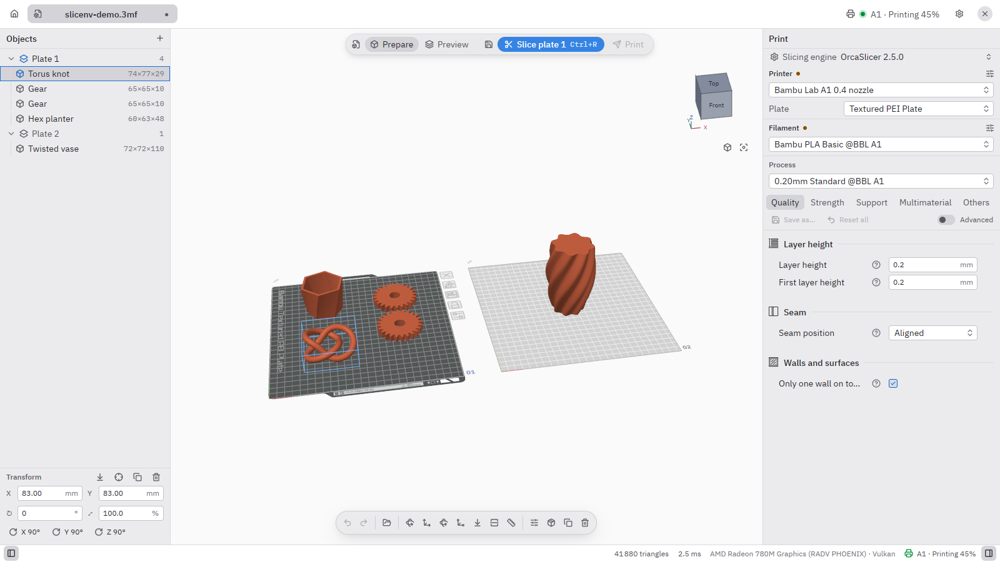
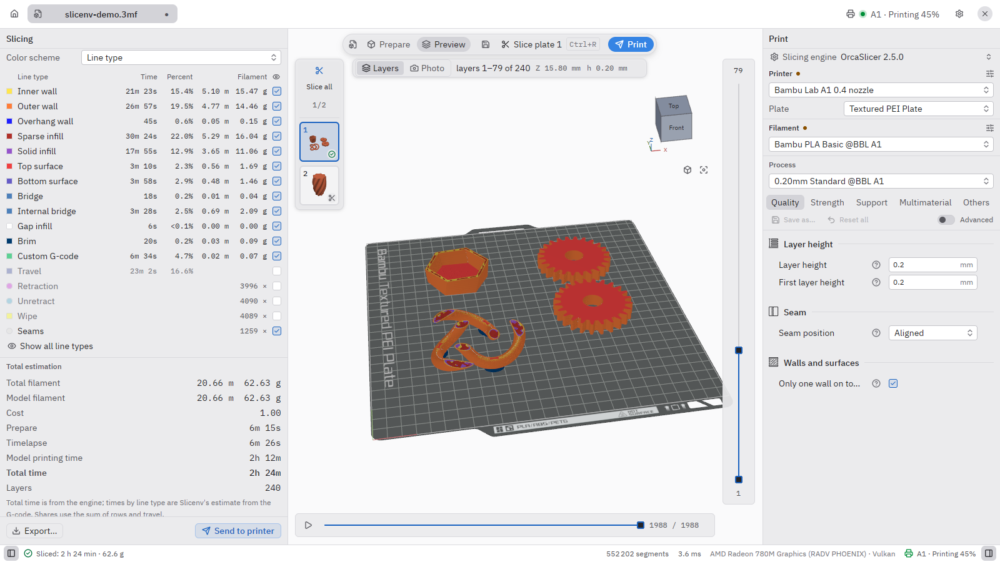
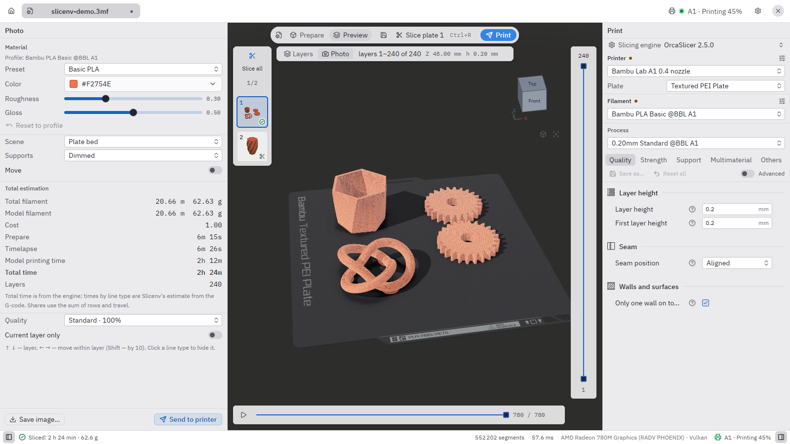
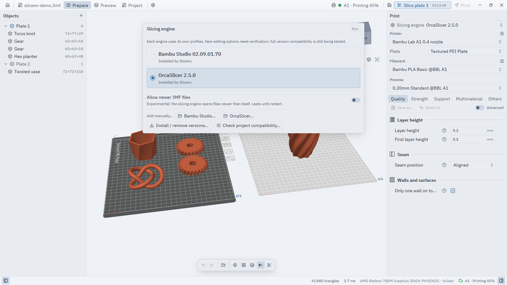
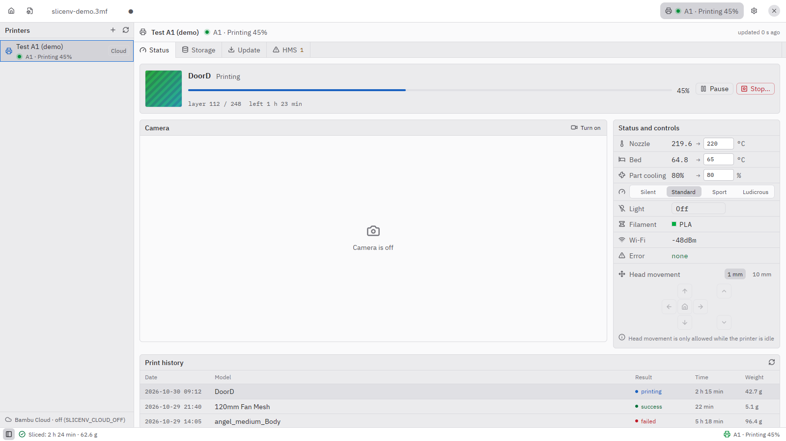

#  Slicenv

[](https://github.com/arximus88/slicenv/actions/workflows/ci.yml)
[](LICENSE)


**English** · [Українська](README.uk.md)

Slicenv is a fast native front-end for 3D printing, written in Rust with GPUI and wgpu. You use it to arrange models on plates and preview the G-code, and it sends the job to your printer. The slicing itself is done by an engine you already trust: **OrcaSlicer** or **Bambu Studio**, called through its command line. You get the same G-code in a much lighter app.

Slicenv is an independent project. It is not affiliated with or endorsed by Bambu Lab or the OrcaSlicer team.



| | |
|---|---|
|  **Preview:** layers, line types, time and filament |  **Photo mode:** the sliced plate rendered in your filament |
|  **Engines:** several OrcaSlicer and Bambu Studio versions side by side |  **Printer:** status, temperatures and controls |

## Features

- **Prepare**
  - Named plates, objects, parts, assemblies, modifiers and negative volumes.
  - Move, rotate and scale; auto-orient (`Q`) and arrange.
  - Measure tool (`U`) with scale-to-distance. Cut plane, navigation cube, undo/redo.
  - Full context menus for objects and plates.
- **Slicing engines**
  - OrcaSlicer and Bambu Studio. Installed engines are found automatically.
  - The built-in engine manager downloads official releases from GitHub, checks their SHA-256 and keeps several versions side by side.
  - If an engine crashes on a project, Slicenv retries in a compatibility mode and offers another engine.
  - Settings can be migrated between engines.
- **Profiles**
  - Printer, process and filament presets come from the engine's own profiles.
  - Edit them: filament overrides, multi-line G-code, illustrated help for each setting.
  - The interface is in English and Ukrainian, switchable live. Setting labels come from the engine's own translations.
- **Preview**
  - Layers and toolpaths, layer and move sliders, colour schemes (line type, speed, flow, fan, temperature), time and filament estimates.
  - **Photo mode** renders the sliced plate as the finished print. The material comes from your filament profile (Matte, Silk, PETG, Marble, CF and more), with studio lighting and visible layer lines. You can save a PNG up to 3840 px ([docs/PHOTO-MODE.md](docs/PHOTO-MODE.md)).
- **Printer (Bambu Lab)**
  - **LAN mode:** discovery, status, camera and printing in pure Rust, without the Bambu plugin or an account ([docs/LAN.md](docs/LAN.md)).
  - **Bambu Connect:** one click hands the sliced file to the official Bambu Connect app.
  - **Bambu Cloud:** status, temperatures, print history and camera. You can sign in through the browser or reuse an existing Bambu Studio session. This works on Linux x86_64 and Windows x64 only, and needs Bambu Lab's closed-source network plugin. Slicenv does not ship the plugin; it downloads it only with your consent ([docs/CLOUD.md](docs/CLOUD.md)).
- **Printer (Klipper)**
  - **Moonraker:** add a Klipper printer by address (plus an API key if Moonraker requires one), see its status, temperatures and camera snapshots, pause, resume or cancel, and upload G-code with or without starting the print. So far this has been tested only against a Moonraker emulator, not on real hardware ([docs/KLIPPER.md](docs/KLIPPER.md)).
- **Model library:** thumbnails for STL, 3MF, OBJ and G-code from folders you choose, with search and live updates.
- **MCP for AI agents:** the `slicenv-mcp` stdio server, and an HTTP server built into the app that edits the open project live with shared undo ([docs/MCP.md](docs/MCP.md)).

## Why Slicenv?

OrcaSlicer and Bambu Studio are excellent slicers, but their interfaces are heavy. Both are built on wxWidgets with an embedded WebKit and keep every vendor profile in memory. Slicenv keeps their slicing engines and replaces only the interface.

Measured on a Ryzen 7 7840HS with a Radeon 780M; the method and full tables are in [docs/BENCHMARK.md](docs/BENCHMARK.md):

| | Slicenv | Bambu Studio 2.7–2.8 | OrcaSlicer 2.4–2.5 |
|---|---:|---:|---:|
| Main window after launch | **0.2 s** | 1.4–1.6 s | 0.8–4.0 s |
| Memory when idle (PSS) | **82–88 MB** | 919–970 MB | 762–887 MB |
| Open a 3MF with 1 M triangles and 4 plates | **0.8 s, 278 MB** | 10.2 s, 1335 MB | — |

There are also costs:
- **Slicing is slower.** Slicenv runs the engine as a separate process, so slicing takes longer than inside Bambu Studio itself: 0.9 s vs 0.45 s on a small plate, 3.4 s vs 0.8 s on the heavy one.
- **Orbiting uses more GPU.** The 3D view is read back from the GPU, so orbiting the camera costs more GPU time than in the originals.

## FAQ

**Why can't Slicenv print through Bambu Cloud?**
Bambu Lab's network plugin accepts cloud print jobs only from software signed by Bambu Lab; anything else gets error `-26`. Slicenv cannot honestly get around this. To print over the internet, Slicenv hands the file to Bambu Connect. On your local network it prints directly in LAN mode. Status and camera over the cloud still work.

**Do I need OrcaSlicer or Bambu Studio installed?**
Yes, one of them does the slicing. If neither is installed, the first-run wizard can download an official build for you.

**Does Slicenv include the engines or the Bambu plugin?**
No. The engines (both AGPL-3.0) and the optional closed-source Bambu plugin are downloaded only when you ask for them.

## Platforms

| OS | Status |
|---|---|
| **Linux x86_64** (Wayland/X11) | Main platform. Packages tested on Arch, Fedora, Ubuntu, Debian, openSUSE and NixOS. |
| **Windows 10/11 x64** | Works and is tested on real hardware. Portable zip. |
| **macOS** (Apple Silicon / Intel) | Experimental: the code is ported but not yet run on a real Mac. No Bambu Cloud ([docs/PORTING.md](docs/PORTING.md)). |

## Install

The first release, **v0.1.0**, is on [GitHub Releases](https://github.com/arximus88/slicenv/releases).

| Channel | Status |
|---|---|
| tar.gz, AppImage, .deb, .rpm, Windows zip | [Releases](https://github.com/arximus88/slicenv/releases) |
| Nix | `nix run github:arximus88/slicenv` |
| Flathub (`app.borys.slicenv`) | being submitted, not available yet |
| AUR (`slicenv-bin`, `slicenv-git`) | being submitted, not available yet |

The Flathub and AUR packaging is already in [packaging/](packaging/README.md); publishing progress is tracked in [docs/PUBLISHING.md](docs/PUBLISHING.md).

## Build from source

You need:
- Rust 1.97.1 on Linux and Windows (this is the CI version), or 1.99.1+ on macOS;
- CMake 3.18+, a C++17 compiler and git. The first build fetches and compiles the Manifold geometry kernel, so it needs network access.
- System libraries on Linux:
  - **Debian/Ubuntu:**
    ```sh
    sudo apt-get install pkg-config cmake clang libssl-dev libzstd-dev libfontconfig-dev \
      libfreetype-dev libwayland-dev libxkbcommon-dev libxkbcommon-x11-dev libx11-xcb-dev libxcb1-dev
    ```
  - **Arch:**
    ```sh
    sudo pacman -S --needed base-devel cmake clang fontconfig freetype2 wayland libxkbcommon libx11 libxcb vulkan-icd-loader
    ```

```sh
cargo run --release                 # the app (crates/app is the default member)
cargo run --release -- model.3mf    # open a file directly
cargo build --release -p mcp        # the slicenv-mcp server
```

To build packages, use `tools/package.sh` on Linux, `tools/package-windows.ps1` on Windows and `tools/package-macos.sh` on macOS.

## Contributing

Issues and pull requests are welcome. Before opening a PR, run `bash .claude/skills/verify/verify.sh`. It checks translations, runs clippy with the CI allow-list and runs the tests with a temporary HOME; details are in [docs/TESTING.md](docs/TESTING.md).
- New Ukrainian UI strings need an English key appended to the end of `crates/app/locales/en.json`.
- Please don't run `cargo fmt --all` on the whole tree.
- Notes for AI coding agents are in [AGENTS.md](AGENTS.md).
- The full documentation index is [docs/INDEX.md](docs/INDEX.md).

## License

Slicenv is licensed under [AGPL-3.0-or-later](LICENSE). Third-party components are listed in [THIRD-PARTY-NOTICES.md](THIRD-PARTY-NOTICES.md).

Bambu Lab, Bambu Studio and Bambu Connect are trademarks of their respective owners, and OrcaSlicer is a project of its own team. These names are used only to identify compatible software and hardware.
