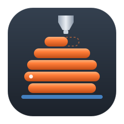
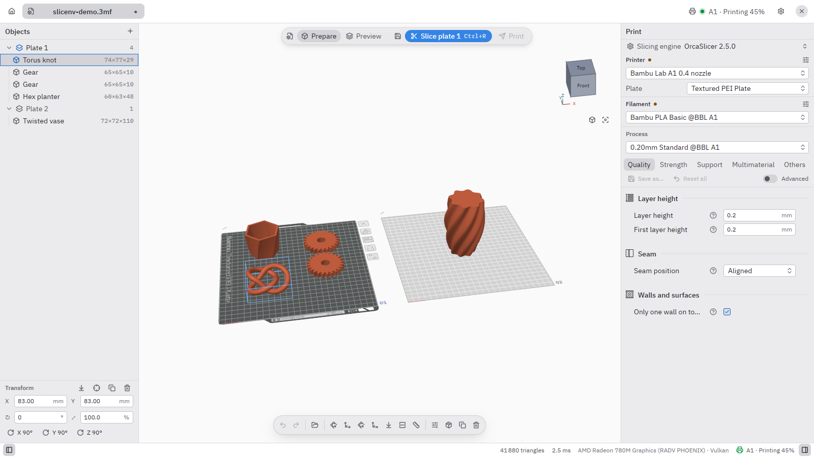
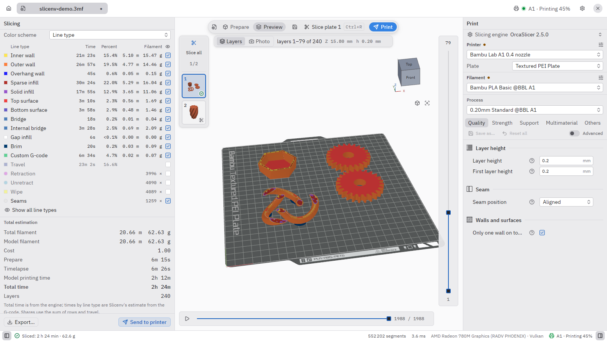
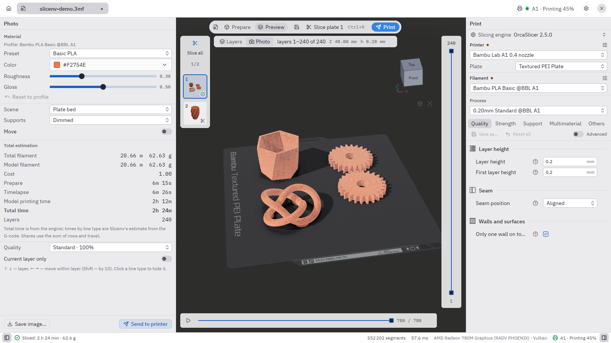
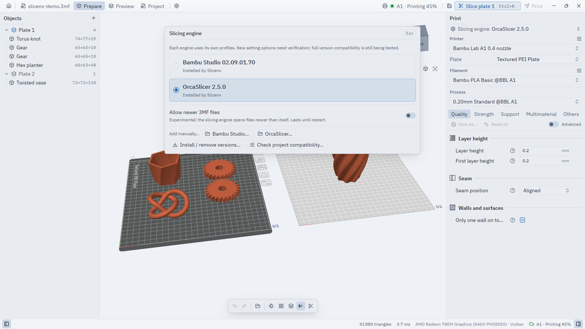
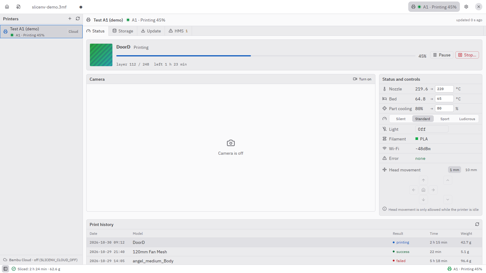

#  Slicenv

[](https://github.com/arximus88/slicenv/actions/workflows/ci.yml)
[](LICENSE)


[English](README.md) · **Українська**

Slicenv — швидкий нативний застосунок для 3D-друку на Rust, GPUI і wgpu. У ньому готують моделі на пластинах, переглядають G-code і надсилають завдання на принтер. Ріже рушій, якому ви вже довіряєте: **OrcaSlicer** або **Bambu Studio** через їхній CLI. G-code той самий, а застосунок значно легший.

Slicenv — незалежний проєкт, не пов’язаний з Bambu Lab чи командою OrcaSlicer і не схвалений ними.



| | |
|---|---|
|  **Перегляд:** шари, типи ліній, час і філамент |  **«Фото»:** нарізана пластина у вашому філаменті |
|  **Рушії:** кілька версій OrcaSlicer і Bambu Studio поруч |  **Принтер:** стан, температури, керування |

## Можливості

- **Підготовка**
  - Пластини з назвами, об’єкти, частини, збірки, модифікатори й негативні об’єми.
  - Переміщення, поворот, масштаб; автоорієнтація (`Q`) і розкладання.
  - Вимірювання (`U`) з масштабуванням під відстань, переріз, навігаційний куб, undo/redo.
  - Повні контекстні меню об’єкта й пластини.
- **Рушії нарізки**
  - OrcaSlicer і Bambu Studio. Встановлені рушії Slicenv знаходить сам.
  - Вбудований менеджер завантажує офіційні збірки з GitHub, перевіряє SHA-256 і тримає кілька версій поруч.
  - Якщо рушій падає на проєкті, Slicenv повторює нарізку в сумісному режимі й пропонує інший рушій.
  - Налаштування можна перенести з одного рушія на інший.
- **Профілі**
  - Принтер, процес і філамент беруться з профілів рушія.
  - Їх можна редагувати: перевизначення філаменту, багаторядковий G-code, ілюстрована довідка до кожного параметра.
  - Інтерфейс українською та англійською, мова перемикається без перезапуску. Підписи налаштувань — з перекладів самого рушія.
- **Перегляд**
  - Шари й траєкторії, повзунки шарів і рухів, схеми кольорів (тип лінії, швидкість, потік, вентилятор, температура), час і витрата філаменту.
  - Режим **«Фото»** показує нарізану пластину як готовий виріб. Матеріал береться з профілю філаменту: Matte, Silk, PETG, Marble, CF тощо. Студійне світло, видимі лінії шарів, збереження PNG до 3840 px ([docs/PHOTO-MODE.md](docs/PHOTO-MODE.md)).
- **Принтер (Bambu Lab)**
  - **Локальна мережа:** пошук, стан, камера й друк на чистому Rust, без плагіна Bambu й акаунта ([docs/LAN.md](docs/LAN.md)).
  - **Bambu Connect:** нарізаний файл в один клік передається в офіційний Bambu Connect.
  - **Bambu Cloud:** стан, температури, історія друку й камера. Вхід через браузер або з наявною сесією Bambu Studio.
    - Працює лише на Linux x86_64 і Windows x64.
    - Потрібен закритий мережевий плагін Bambu Lab. У Slicenv його немає, він завантажується лише за вашою згодою ([docs/CLOUD.md](docs/CLOUD.md)).
- **Принтер (Klipper)**
  - **Moonraker:** принтер з Klipper додається за адресою (і API-ключем, якщо Moonraker його вимагає): стан, температури, знімки камери, пауза, продовження й скасування, завантаження G-code з друком або без.
    - Поки перевірено лише проти емулятора Moonraker, не на справжньому принтері ([docs/KLIPPER.md](docs/KLIPPER.md)).
- **Бібліотека моделей:** мініатюри STL, 3MF, OBJ і G-code з вибраних тек, пошук і стеження за змінами.
- **MCP для AI-агентів:**
  - сервер `slicenv-mcp` (stdio);
  - HTTP-сервер у самому застосунку, що редагує відкритий проєкт наживо зі спільним undo ([docs/MCP.md](docs/MCP.md)).

## Навіщо Slicenv

OrcaSlicer і Bambu Studio — чудові слайсери, але з важким інтерфейсом. Обидва побудовані на wxWidgets з вбудованим WebKit і тримають у пам’яті всі вендорні профілі. Slicenv лишає їхні рушії нарізки й замінює лише інтерфейс.

Виміри на Ryzen 7 7840HS / Radeon 780M, методика й повні таблиці — у [docs/BENCHMARK.md](docs/BENCHMARK.md):

| | Slicenv | Bambu Studio 2.7–2.8 | OrcaSlicer 2.4–2.5 |
|---|---:|---:|---:|
| Головне вікно після запуску | **0,2 с** | 1,4–1,6 с | 0,8–4,0 с |
| Пам’ять у простої (PSS) | **82–88 МБ** | 919–970 МБ | 762–887 МБ |
| Відкриття 3MF на 1 млн трикутників, 4 пластини | **0,8 с, 278 МБ** | 10,2 с, 1335 МБ | — |

Чим за це платите:
- **Нарізка повільніша.** Рушій запускається окремим процесом, тому нарізка довша, ніж усередині самого Bambu Studio: 0,9 с проти 0,45 с на малій пластині й 3,4 с проти 0,8 с на важкій.
- **Обертання камери навантажує відеокарту більше.** Кадр 3D читається назад з відеокарти, тому обертання бере більше GPU, ніж в оригіналах.

## Часті питання

**Чому Slicenv не друкує через Bambu Cloud?**
Мережевий плагін Bambu Lab приймає хмарні завдання лише від програм, підписаних Bambu Lab; решта отримує помилку `-26`. Чесно це не обійти. Для друку через інтернет Slicenv передає файл у Bambu Connect, у локальній мережі друкує напряму. Стан і камера через хмару працюють.

На Linux, де Bambu Connect немає, можна самому вибрати сторонній відкритий плагін Open Bamboo Networking (збірка persano). Він друкує без Developer Mode, але містить ключ, витягнутий із програми Bambu, тож лише на ваш розсуд. Slicenv його не постачає: копіює вже встановлений в OrcaSlicer або за згодою завантажує реліз persano з GitHub ([docs/OPEN-PLUGIN.md](docs/OPEN-PLUGIN.md)).

**Чи потрібен встановлений OrcaSlicer або Bambu Studio?**
Так, ріже один із них. Якщо жодного немає, майстер першого запуску завантажить офіційну збірку.

**Чи входять у Slicenv рушії або плагін Bambu?**
Ні. Рушії (обидва під AGPL-3.0) і необов’язковий закритий плагін Bambu завантажуються лише за вашою дією.

## Платформи

| ОС | Стан |
|---|---|
| **Linux x86_64** (Wayland/X11) | Основна платформа. Пакети перевірено на Arch, Fedora, Ubuntu, Debian, openSUSE і NixOS. |
| **Windows 10/11 x64** | Працює, перевірено на справжній машині. Портативний zip. |
| **macOS** (Apple Silicon / Intel) | Експериментально: код портовано, але на справжньому Mac ще не запускався. Без Bambu Cloud ([docs/PORTING.md](docs/PORTING.md)). |

## Встановлення

Перший реліз, **v0.1.0**, — у [GitHub Releases](https://github.com/arximus88/slicenv/releases).

| Канал | Стан |
|---|---|
| tar.gz, AppImage, .deb, .rpm, zip для Windows | [Releases](https://github.com/arximus88/slicenv/releases) |
| Nix | `nix run github:arximus88/slicenv` |
| Flathub (`app.borys.slicenv`) | подається, ще недоступний |
| AUR (`slicenv-bin`, `slicenv-git`) | подається, ще недоступний |

Пакування для Flathub і AUR уже в [packaging/](packaging/README.md), хід публікації — у [docs/PUBLISHING.md](docs/PUBLISHING.md).

## Збірка з вихідного коду

Потрібні:
- Rust 1.100.0 (зафіксовано в `rust-toolchain.toml`; rustup сам поставить його при першому `cargo`);
- CMake 3.18+, компілятор C++17 і git. Перша збірка завантажує й компілює геометричне ядро Manifold, тому потрібна мережа;
- системні бібліотеки на Linux:
  - **Debian/Ubuntu:**
    ```sh
    sudo apt-get install pkg-config cmake clang libssl-dev libzstd-dev libfontconfig-dev \
      libfreetype-dev libwayland-dev libxkbcommon-dev libxkbcommon-x11-dev libx11-xcb-dev libxcb1-dev
    ```
  - **Arch:**
    ```sh
    sudo pacman -S --needed base-devel cmake clang fontconfig freetype2 wayland libxkbcommon libx11 libxcb vulkan-icd-loader
    ```

```sh
cargo run --release                 # застосунок (crates/app — default member)
cargo run --release -- model.3mf    # одразу відкрити файл
cargo build --release -p mcp        # сервер slicenv-mcp
```

Пакети збирають `tools/package.sh` на Linux, `tools/package-windows.ps1` на Windows і `tools/package-macos.sh` на macOS.

## Внесок

Issues і pull requests вітаються. Перед PR запустіть `bash .claude/skills/verify/verify.sh`: перевірка перекладів, clippy з allow-списком CI і тести з тимчасовим HOME. Деталі — у [docs/TESTING.md](docs/TESTING.md).

- Новий український рядок інтерфейсу потребує англійського ключа в кінці `crates/app/locales/en.json`.
- Не запускайте `cargo fmt --all` на все дерево.
- Інструкції для AI-агентів — [AGENTS.md](AGENTS.md).
- Уся документація — [docs/INDEX.md](docs/INDEX.md).

## Ліцензія

Slicenv поширюється під ліцензією [AGPL-3.0-or-later](LICENSE). Сторонні компоненти перелічено в [THIRD-PARTY-NOTICES.md](THIRD-PARTY-NOTICES.md).

Bambu Lab, Bambu Studio і Bambu Connect — торгові марки їхніх власників, OrcaSlicer — проєкт власної команди. Назви вживаються лише для позначення сумісного ПЗ та обладнання.
