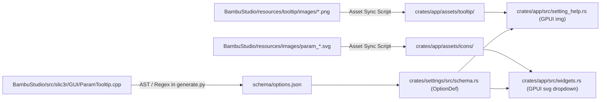

# Illustrated Help & Setting Visuals Architecture

## Executive Summary

This document specifies the technical design for introducing illustrated tooltips, rich parameter cards, and enum pattern icons into the `slicenv` desktop application. It is based on a read-only audit of upstream implementations in **BambuStudio** and **OrcaSlicer**, cross-referenced with `crates/app/src/setting_help.rs`, `preset_editor.rs`, and `crates/settings/tools/generate.py`.

The design establishes a **two-tier assistance model**:
1. **Tier 1 (Bounded Hover Card)**: Fast, non-intrusive tooltip (280–320 px) with setting summary, theme-aware visual thumbnail (256 px), and bulleted key points.
2. **Tier 2 (Modal / Inspector View)**: Persistent dialog (`open_setting_help`) with full-resolution diagrams, detailed trade-offs, configuration keys, and direct Wiki deep links.

---

## 1. Upstream Audit & Provenance

### 1.1 Rich Illustrated Tooltips (`ParamTooltip`)

In BambuStudio, illustrated tooltips are handled by a dedicated native hover card:
- **C++ Headers & Implementation**:
  - `<BambuStudio-src>/src/slic3r/GUI/ParamTooltip.hpp`
  - `<BambuStudio-src>/src/slic3r/GUI/ParamTooltip.cpp`
- **Key Symbols**:
  - `class Slic3r::GUI::ParamTooltip`: Singleton window inheriting `wxPopupWindow` (avoiding GTK pointer grabs on Linux).
  - `class Slic3r::GUI::ParamTipStore`: Static registry populated by `ParamTipStore::build_store()`.
  - `struct ParamTipEntry`: Stores `image` (base identifier), `description`, `details` (newline-delimited bullets), `note` (remind/warning text), and `value_tips` (per-enum-value tips).
  - `ParamTipEntry make_entry(...)`: Constructor helper (`ParamTooltip.cpp:130`).
  - `LoadImage(image_id, dark)`: Resolves `${resources_dir}/tooltip/images/${image_id}${dark ? "_dark" : ""}.png` (`ParamTooltip.cpp:688`).
  - `ParamTooltip::ItemTooltip(opt_key, value_key)`: Looks up per-dropdown-item tooltips (`ParamTooltip.cpp:1025`).

#### Asset Inventory & Specifications
- **Location**: `<BambuStudio-src>/resources/tooltip/images/`
- **File Count**: Exactly **78 PNG files** (39 unique illustrations × 2 variants: light and `_dark.png`).
- **Dimensions & Format**:
  - Format: PNG, 8-bit RGB non-interlaced, alpha transparency.
  - Typical dimensions: `1213 × 840 px` (`bottom_color_penetration_layers.png`), `1440 × 622 px` (`bottom_surface_pattern.png`).
  - Rendering Target: Scaled uniformly to `IMAGE_W = 256 DIP` centered inside `CARD_WIDTH = 300 DIP` (`PAD = 12 DIP`, `GAP = 8 DIP`).
- **Provenance & License**:
  - Upstream project license: **GNU AGPLv3** (`BambuStudio/LICENSE`).
  - Art style: Language-neutral 2.5D orthographic slice diagrams; zero baked-in text; works against both light and dark backgrounds.

#### Contrast with OrcaSlicer
- OrcaSlicer maintains an HTML/CSS/JS copy in `resources/tooltip/` but does **not** ship the 78 `resources/tooltip/images/*.png` cards.
- Instead, OrcaSlicer documents procedural texture displacement tooltips in `<OrcaSlicer-src>/docs/HLSD/tooltip-illustrations.md` (ImGui panel, `AnimatedTexture.hpp`, neutral grey PNG/GIF loops at 256 px / 192 px 16 frames).

---

### 1.2 Setting Keys to Tooltip Images: The Paint Penetration Example

The mapping from setting keys to illustrated images is explicitly declared in `BambuStudio/src/slic3r/GUI/ParamTooltip.cpp`:

```cpp
// ParamTooltip.cpp lines 220-231
{"top_color_penetration_layers",
 make_entry("top_color_penetration_layers",
            _L("Controls how many layers the top-surface color penetrates downward, keeping other filament colors inside from showing through."),
            _L("Fewer layers make color bleed-through more likely.\n"
               "More layers reduce bleed-through but increase the number of filament changes.\n"
               "To keep the downward penetration from affecting the model's side colors, the penetrated area shrinks layer by layer."))},
{"bottom_color_penetration_layers",
 make_entry("bottom_color_penetration_layers",
            _L("Controls how many layers the bottom-surface color penetrates upward, keeping other filament colors inside from showing through."),
            _L("Fewer layers make color bleed-through more likely.\n"
               "More layers reduce bleed-through but increase the number of filament changes.\n"
               "To keep the upward penetration from affecting the model's side colors, the penetrated area shrinks layer by layer."))},
```

- **Setting Key**: `bottom_color_penetration_layers`
- **Image Identifier**: `"bottom_color_penetration_layers"`
- **On-disk Light Asset**: `<BambuStudio-src>/resources/tooltip/images/bottom_color_penetration_layers.png` (1213 × 840 px)
- **On-disk Dark Asset**: `<BambuStudio-src>/resources/tooltip/images/bottom_color_penetration_layers_dark.png` (1213 × 840 px)
- **Slicer Config Source**: `PrintConfig.cpp:6180` (Bambu) / `PrintConfig.cpp:1545` (Orca), integer type, range `[1, max]`.
- **Core Meaning Illustrated**: Visualizes multi-color segmentation layers penetrating from the bottom shell upward into internal infill without bleeding into the exterior perimeter walls.

---

### 1.3 Pattern Enum Icons (`top_surface_pattern` & `bottom_surface_pattern`)

Both BambuStudio and OrcaSlicer display vector icons inside dropdown options for surface patterns.

#### Slicer Config Definition
In `src/libslic3r/PrintConfig.cpp:2147-2201`:
`top_surface_pattern` and `bottom_surface_pattern` share `ConfigOptionEnum<InfillPattern>`:
- `concentric`
- `zig-zag` (displayed as "Rectilinear")
- `monotonic`
- `monotonicline` ("Monotonic line")
- `globalmonotonicline` ("Global monotonic line")
- `alignedrectilinear` ("Aligned Rectilinear")
- `hilbertcurve` ("Hilbert Curve")
- `archimedeanchords` ("Archimedean Chords")
- `octagramspiral` ("Octagram Spiral")

#### Dynamic Binding Code
In `BambuStudio/src/slic3r/GUI/Field.cpp:1211-1218`:
```cpp
int i = 0;
boost::filesystem::path image_path(Slic3r::resources_dir());
image_path /= "images";
for (auto el : m_opt.enum_labels) {
    auto icon_name = "param_" + m_opt.enum_values[i];
    if (boost::filesystem::exists(image_path / (icon_name + ".svg"))) {
        ScalableBitmap bm(temp, icon_name, 24);
        temp->Append(_(el), bm.bmp());
    } else {
        temp->Append(_(el));
    }
    // Per-value tip shown when hovering this dropdown item
    const wxString item_tip = ParamTooltip::ItemTooltip(m_opt_id, m_opt.enum_values[i]);
    if (!item_tip.IsEmpty()) temp->SetItemTooltip(i, item_tip);
    ++i;
}
```

#### On-disk Asset Resolution
Every enum value maps 1:1 to an SVG file in `<BambuStudio-src>/resources/images/`:
- `"concentric"` → `param_concentric.svg`
- `"zig-zag"` → `param_zig-zag.svg`
- `"monotonic"` → `param_monotonic.svg`
- `"monotonicline"` → `param_monotonicline.svg`
- `"globalmonotonicline"` → `param_globalmonotonicline.svg`
- `"alignedrectilinear"` → `param_alignedrectilinear.svg`
- `"hilbertcurve"` → `param_hilbertcurve.svg`
- `"archimedeanchords"` → `param_archimedeanchords.svg`
- `"octagramspiral"` → `param_octagramspiral.svg`

Format: Scalable Vector Graphics (SVG), variable coordinate grids (for example 10 × 10 for `param_monotonic.svg`), rendered by Studio at 24 px; stroke-based paths adaptable to theme tints. License: **GNU AGPLv3**.

---

## 2. Proven Mappings vs. Proposals

| Category | Upstream Proven Reality | Proposed Architecture for `custom/slicenv` |
|---|---|---|
| **Hover Card Width** | Fixed `300 DIP` (`IMAGE_W = 256 DIP`) | GPUI bounded tooltip `320 px` (`img` sized to `256 px` width, auto height) |
| **Theme Switching** | Appends `_dark.png` when `dark == true` | Check GPUI theme state; bind `format!("{image_id}{theme_suffix}.png")` |
| **Enum Icons** | `Field.cpp` prepends `"param_" + enum_value + ".svg"` | Load SVG asset `icons/param_{enum_val}.svg` into GPUI `Dropdown` row |
| **Data Extraction** | Hardcoded C++ map in `ParamTooltip.cpp` | Python script `crates/settings/tools/generate.py` extracts to `options.json` |
| **Full Help View** | Upstream only has popup card + browser Wiki link | Dual system: Bounded hover card + existing in-app modal (`open_setting_help`) |
| **Dropdown Item Tips** | `ParamTooltip::ItemTooltip` sets per-item tip | Future enhancement: hover card on individual dropdown menu items |

---

## 3. High-Value First Illustrations (Top 5)

These 5 settings address the most frequent user confusion, have verified high-quality illustrations in upstream `BambuStudio`, and provide clear graphical clarity:

### 1. `bottom_color_penetration_layers` & `top_color_penetration_layers`
- **Keys**: `bottom_color_penetration_layers`, `top_color_penetration_layers`
- **Illustrated Asset**: `tooltip/images/bottom_color_penetration_layers.png` / `_dark.png`
- **Why high-value**: Multi-material prints often suffer from the infill color bleeding through bottom or top surfaces. The illustration shows a stepped cross-section demonstrating how layers taper inward to protect perimeter quality while preventing bleed.
- **Upstream Text**: "Controls how many layers the bottom-surface color penetrates upward, keeping other filament colors inside from showing through."

### 2. `top_surface_pattern` & `bottom_surface_pattern`
- **Keys**: `top_surface_pattern`, `bottom_surface_pattern`
- **Illustrated Asset**: `tooltip/images/top_surface_pattern.png` / `bottom_surface_pattern.png`
- **Dropdown SVGs**: `param_concentric.svg`, `param_monotonic.svg`, `param_monotonicline.svg`, `param_alignedrectilinear.svg`, `param_hilbertcurve.svg`, `param_archimedeanchords.svg`, `param_octagramspiral.svg`.
- **Why high-value**: Geometric pattern names are abstract. Showing the 24px SVG beside each option in the dropdown and the full toolpath photo in the tooltip gives immediate visual feedback.

### 3. `wall_loops`
- **Keys**: `wall_loops`
- **Illustrated Asset**: `tooltip/images/wall_loops.png` / `_dark.png`
- **Why high-value**: Direct indicator of structural strength and print duration. The graphic shows 1 vs 2 vs 3 concentric perimeters and how internal infill interfaces with them.

### 4. `bottom_shell_layers` & `top_shell_layers`
- **Keys**: `bottom_shell_layers`, `top_shell_layers`, `bottom_shell_thickness`, `top_shell_thickness`
- **Illustrated Asset**: `tooltip/images/bottom_shell_layers.png` / `top_shell_layers.png`
- **Why high-value**: Slicers calculate solid shells dynamically using both layer count and minimum thickness (`mm`). The graphic shows how thin layer heights automatically trigger extra shell layers.

### 5. `seam_position`
- **Keys**: `seam_position`
- **Illustrated Asset**: `tooltip/images/seam_position.png` / `_dark.png`
- **Value Tips**: `nearest`, `aligned`, `back`, `random`
- **Why high-value**: Eliminates trial-and-error by demonstrating where perimeter start/end retraction zits align on sharp corners vs cylindrical surfaces.

---

## 4. Minimal Portable Pipeline

A lightweight, non-invasive pipeline to incorporate these assets without manual duplication:



### Step 1: Metadata Extraction (`crates/settings/tools/generate.py`)
Add a parser routine in `generate.py` that scans `BambuStudio/src/slic3r/GUI/ParamTooltip.cpp`:
1. Match `{"opt_key", make_entry("image_id", _L("desc"), _L("details"), _L("note"))}`.
2. Store fields in `OptionDef`:
   ```rust
   pub struct OptionDef {
       // ... existing fields ...
       #[serde(default)]
       pub illustration: Option<String>,
       #[serde(default)]
       pub details: Vec<String>,
       #[serde(default)]
       pub note: Option<String>,
       #[serde(default)]
       pub value_tips: BTreeMap<String, String>,
   }
   ```
3. Update `crates/settings/src/schema.rs` with getters and fallback logic.

### Step 2: Asset Packaging (`crates/app/src/assets.rs`)
1. Place selected PNGs under `crates/app/assets/tooltip/` and pattern SVGs under `crates/app/assets/icons/`.
2. Extend `crates/app/src/assets.rs`:
   - Prefix `tooltip/{name}.png` maps to embedded or disk assets.
   - SVG icons load via `gpui::svg().path(format!("icons/param_{val}.svg"))`.

### Step 3: UI Component Wiring

#### A. Enhanced Bounded Tooltip (`crates/app/src/setting_help.rs`)
Refactor `pub fn tooltip(...)`:
- Fixed container width: `px(320.)`.
- Header: Label / Title.
- Image block: If `def.illustration` is present:
  ```rust
  let img_path = format!("tooltip/{}{}.png", img_id, if is_dark { "_dark" } else { "" });
  div().w_full().flex().justify_center().child(
      gpui::img(img_path).w(px(256.)).rounded(px(4.))
  )
  ```
- Summary text (max 2-3 lines).
- Bulleted details (1-3 key takeaways).
- Hint footer: `"? — повний опис і посилання на Wiki"`.

#### B. Rich Enum Dropdowns (`crates/app/src/widgets.rs` & `preset_editor.rs`)
In `Dropdown`:
- Extend `DropdownItem` to accept `icon: Option<SharedString>` (or SVG path).
- In `select_for`, for any enum matching `param_{val}.svg`, supply the icon path.
- Render `gpui::svg().path(icon_path).size(px(16.))` directly preceding the option label in the trigger button and menu popover.

---

## 5. Multilingual Extensibility (Ukrainian & English)

### 5.1 Language-Neutral Asset Design
Upstream illustrations strictly adhere to a **no-text-in-pixels** rule:
- All dimensional annotations use neutral geometric markings or numbers.
- Text labels, legends, and explanations are rendered in code using localized strings.
- Assets do not need localized variants (no `_uk.png` or `_en.png`). A single asset set serves all languages.

### 5.2 Translation Fallback Hierarchy
For text fields (`description`, `details`, `note`, `value_tips`):
1. **Target Locale** (e.g. `uk` from PO catalogs or curated overrides).
2. **English Source** (`ParamTooltip.cpp` strings).
3. **Empty / Hidden**: If details or notes are absent, the corresponding UI block collapses with zero layout jump.

In `schema.rs`:
```rust
impl OptionDef {
    pub fn illustration_image(&self) -> Option<&str> {
        self.illustration.as_deref()
    }

    pub fn details(&self, locale: Locale) -> &[String] {
        if locale == Locale::Uk && !self.uk_details.is_empty() {
            &self.uk_details
        } else {
            &self.details
        }
    }
}
```

---

## 6. Implementation Safety & Performance Guardrails

1. **Deterministic Sizing**: Hover cards must have an explicit width (`320 px`) and clamped height to prevent layout thrashing and jitter during cursor movement.
2. **Cached Decoding**: PNGs should be decoded on first hover and cached in GPUI's image cache (as `RenderImage`), preventing frame drops during preset navigation.
3. **Graceful Asset Fallback**: If an image fails to load or is omitted from the build, the card seamlessly degrades to the existing compact text tooltip without visual gaps.
4. **Non-blocking Popups**: Avoid modal grabs on hover cards; use GPUI's existing non-modal tooltip primitives.


## First integrated slice (2026-10-30)

The app now embeds light/dark PNG pairs for four proven keys:
`bottom_color_penetration_layers`, `top_color_penetration_layers`,
`seam_position`, `top_shell_layers` (841,873 bytes total). Hover cards and full
help use these illustrations without requiring an installed Studio resource
directory. Other settings retain their text and Wiki link.

Nine unchanged upstream SVGs are mapped by serialized enum value for
`top_surface_pattern` and `bottom_surface_pattern`. Both the current selection
and dropdown rows display the matching icon; unknown values retain text only.
Source attribution lives alongside each embedded asset group. This is a first
set, not a claim that all 39 upstream illustrations or per-value tips are wired.


Native acceptance: `/tmp/bambu-help-replay` captures bounded illustrated hover
cards in Light/Dark, the full help modal with Wiki and the SVG pattern menu.
`crates/app/verification/help.py` reproduces the captures with cloud disabled.
Mapping tests passed in the workspace run; this first set does not add the
structured ParamTooltip bullet details/value tips yet.
